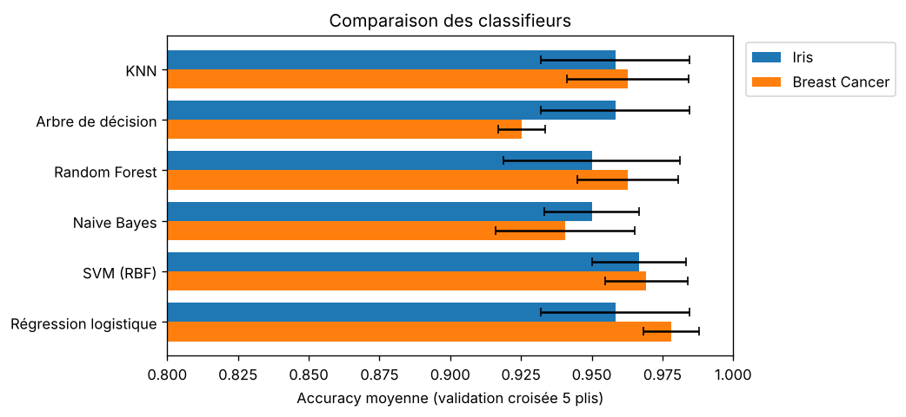
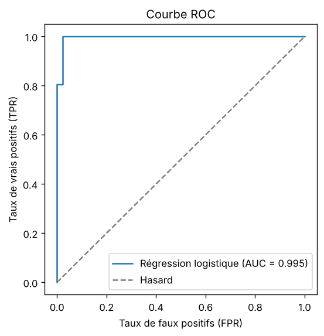
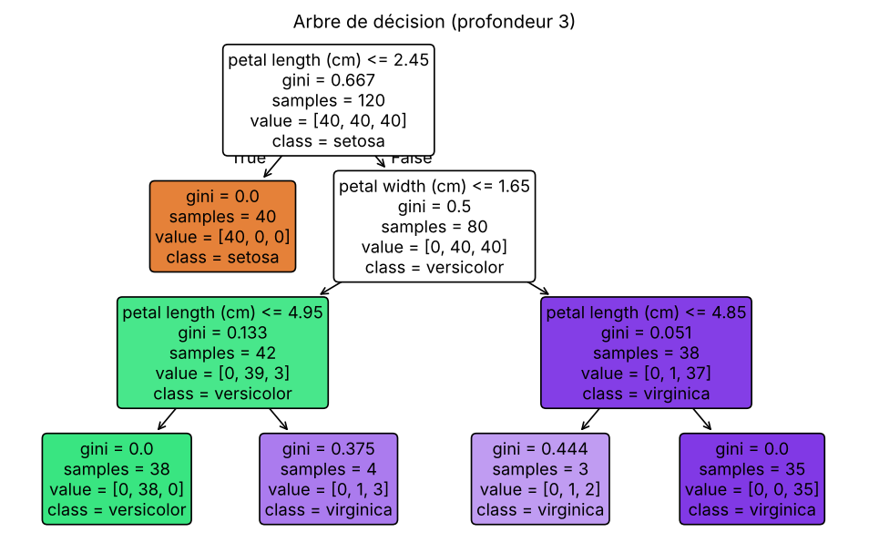
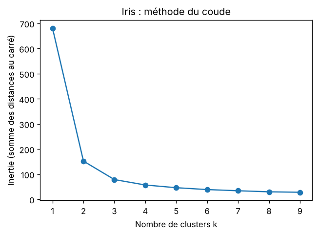
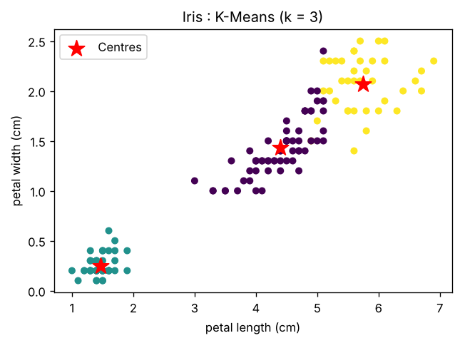

# Machine Learning Algorithms

Implémentation, évaluation et comparaison des principaux algorithmes de Machine Learning en Python (scikit-learn), sur des jeux de données réels.

| Partie | Algorithmes | Dataset |
| --- | --- | --- |
| [Régression](#régression) | Linéaire multiple, polynomiale, Random Forest, SVR | California Housing |
| [Classification](#classification) | KNN, arbre de décision, Random Forest, Naive Bayes, SVM, régression logistique | Iris, Breast Cancer |
| [Clustering](#clustering) | K-Means, DBSCAN | Iris, Mall Customers |

**Bonnes pratiques appliquées dans tout le projet**
- Séparation train / test, et mise à l'échelle apprise **uniquement sur le train** (pipelines scikit-learn) pour éviter la fuite de données.
- Hyperparamètres choisis par **validation croisée** ou par la méthode du coude, jamais sur le jeu de test.
- Résultats reproductibles (`random_state` fixé).
- Métriques de régression (MAE, MSE, RMSE, MAPE, R²) **implémentées à la main** avec NumPy, puis vérifiées contre scikit-learn.

---

## Régression

Prédire la valeur médiane des maisons d'un quartier de Californie à partir de 8 variables (revenu médian, âge des logements, nombre de pièces, localisation…).

| Script | Contenu |
| --- | --- |
| `regression/metrics.py` | MAE, MSE, RMSE, MAPE, R² codés avec NumPy |
| `regression/linear_regression.py` | Régression linéaire multiple, coefficients des variables |
| `regression/polynomial_regression.py` | Comparaison des degrés 1, 2, 3 (compromis biais / variance) |
| `regression/random_forest_regression.py` | Random Forest et importance des variables |
| `regression/svr_regression.py` | SVR à noyau RBF |
| `regression/compare_models.py` | Tous les modèles sur le même découpage, tableau des résultats |

<!-- Lancez `python regression/compare_models.py`, puis collez ici le contenu de results/regression_results.md
     et ajoutez l'image :  -->

---

## Classification

### Comparaison des modèles (validation croisée, 5 plis)

| Modèle | Iris (accuracy) | Breast Cancer (accuracy) |
| --- | --- | --- |
| KNN | 0,958 ± 0,026 | 0,963 ± 0,022 |
| Arbre de décision | 0,958 ± 0,026 | 0,925 ± 0,008 |
| Random Forest | 0,950 ± 0,031 | 0,963 ± 0,018 |
| Naive Bayes | 0,950 ± 0,017 | 0,941 ± 0,025 |
| SVM (RBF) | **0,967 ± 0,017** | 0,969 ± 0,015 |
| Régression logistique | 0,958 ± 0,026 | **0,978 ± 0,010** |



### Détail par algorithme

| Script | Dataset | Contenu | Résultat sur le test |
| --- | --- | --- | --- |
| `classification/explore_iris.py` | Iris | Visualisation des 3 espèces | — |
| `classification/knn.py` | Iris | Choix de k par validation croisée, prédiction d'une nouvelle fleur | accuracy 0,967 |
| `classification/decision_tree.py` | Iris | Arbre de profondeur 3 et sa visualisation | accuracy 0,967 |
| `classification/naive_bayes.py` | Iris | Naive Bayes gaussien | accuracy 0,967 |
| `classification/logistic_regression.py` | Breast Cancer | Matrice de confusion, rapport, courbe ROC | accuracy 0,982 · AUC 0,995 |
| `classification/compare_models.py` | Les deux | Tableau et graphique ci-dessus | — |

| Courbe ROC (régression logistique) | Arbre de décision |
| --- | --- |
|  |  |

---

## Clustering

### K-Means sur Iris — `clustering/kmeans_iris.py`

| Méthode du coude | Résultat K-Means (k = 3) |
| --- | --- |
|  |  |

Silhouette score : 0,553 · Adjusted Rand Index (comparaison avec les vraies espèces) : 0,730.

### Segmentation de clients — `clustering/kmeans_mall_customers.py` et `clustering/dbscan_mall_customers.py`

Regroupement des clients d'un centre commercial selon leur **revenu annuel** et leur **score de dépenses**.
- **K-Means** : k = 5 choisi par la méthode du coude.
- **DBSCAN** : ne demande pas le nombre de clusters et détecte les clients atypiques (bruit). Les données sont standardisées et `eps` est choisi avec le graphe des k-distances.

<!-- Après avoir lancé les deux scripts, ajoutez :   -->

---

## Installation

```bash
git clone https://github.com/zackbn/machine-learning-algorithms.git
cd machine-learning-algorithms
pip install -r requirements.txt
```

Iris et Breast Cancer sont inclus dans scikit-learn. California Housing est téléchargé automatiquement au premier lancement. Pour Mall Customers, voir [data/README.md](data/README.md).

## Utilisation

```bash
python regression/compare_models.py
python classification/compare_models.py
python clustering/kmeans_iris.py
```

Chaque script peut être lancé seul. Les figures sont enregistrées dans `images/` et les tableaux dans `results/`.

## Structure

```
machine-learning-algorithms/
├── regression/        # 4 modèles + métriques codées à la main + comparaison
├── classification/    # 5 scripts + comparaison de 6 classifieurs
├── clustering/        # K-Means et DBSCAN
├── data/              # datasets externes (non versionnés)
├── images/            # figures générées
├── results/           # tableaux de résultats
├── requirements.txt
└── README.md
```

## Auteur

**Zakarya Benani Sadoun** — Étudiant en Master IA & Big Data (ESGI Paris), à la recherche d'une alternance Ingénieur IA · [GitHub](https://github.com/zackbn)
